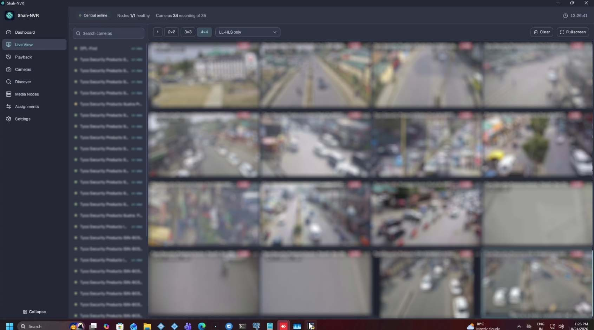
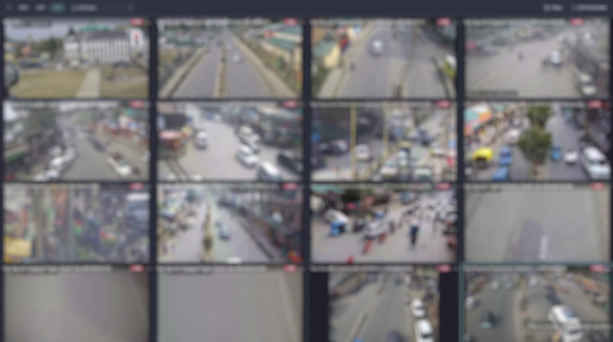
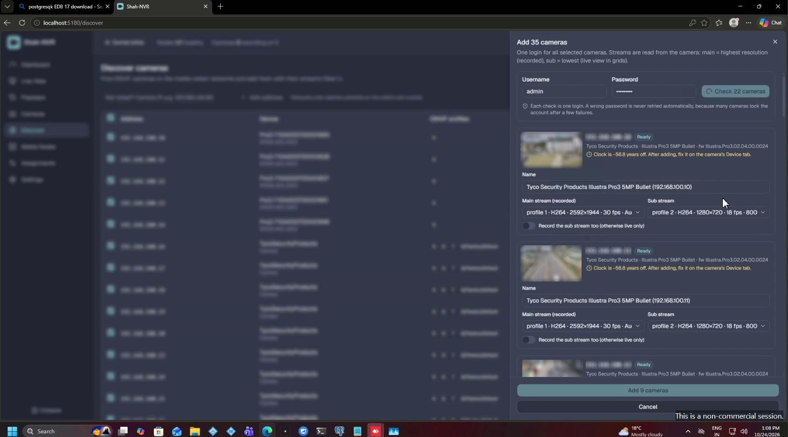
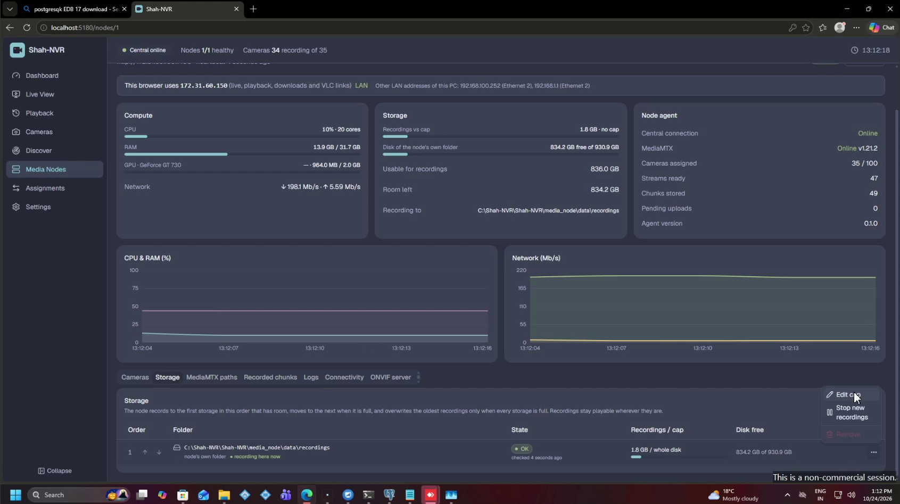
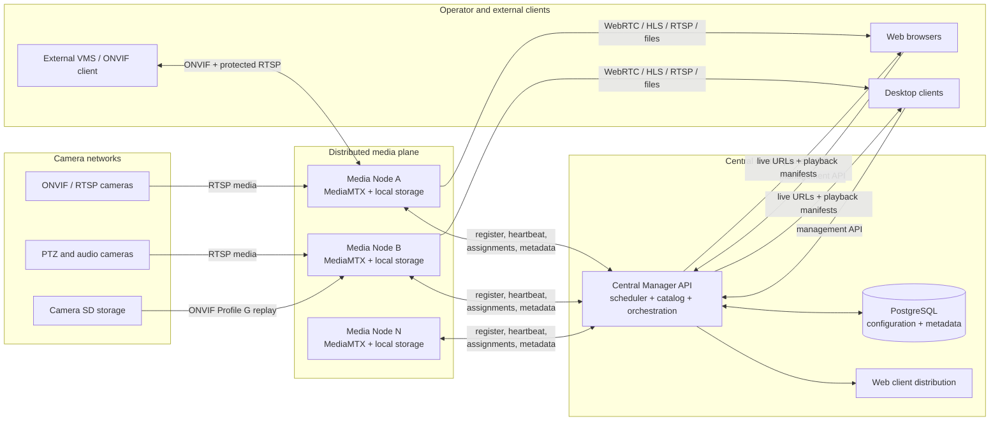
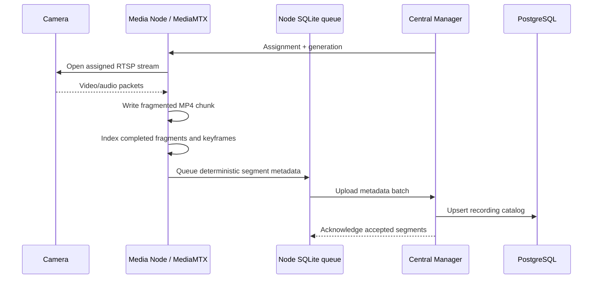
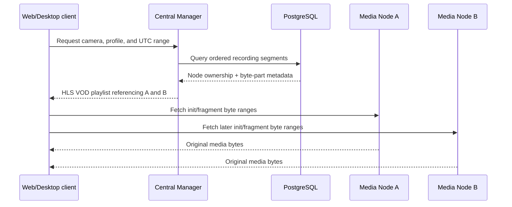
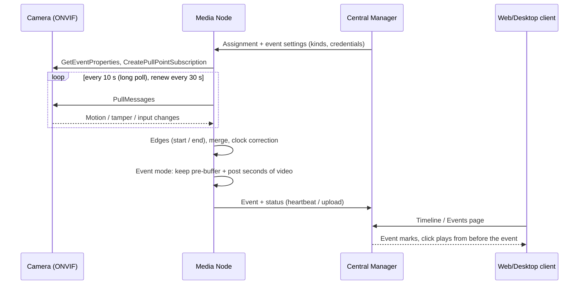

# Shah-NVR

### A distributed, ONVIF-native video platform built to scale from one site to thousands of cameras

<p align="center">
  
</p>
<p align="center">
  <em>Shah-NVR Desktop: a 4×4 Live View of sixteen recording cameras, with the camera list and live cluster status.</em>
</p>

<p align="center">
  <a href="#gallery"><strong>Gallery</strong></a> ·
  <a href="#product-capabilities">Capabilities</a> ·
  <a href="#performance-highlights">Performance</a> ·
  <a href="#architecture">Architecture</a> ·
  <a href="#quick-start-for-development">Quick start</a>
</p>

Shah-NVR is a modern network video recorder and video-management platform for
organizations that need to operate cameras across rooms, buildings, campuses,
branches, and remote sites without sending every video stream through one large
server.

It combines a lightweight central control plane with horizontally scalable media
nodes. Cameras are recorded close to where they are installed, while operators
manage the complete estate through one web or native desktop application.

> **The central idea:** centralize coordination and metadata, distribute the
> bandwidth-heavy video work.

Shah-NVR is under active development and runs in pilot deployments today. Already in place:
- **Recording and playback:** distributed recording and playback, failover, storage management, exports, and
  edge-storage recovery.
- **Scheduling and events:** weekly recording schedules, event recording with a pre-buffer, and camera events from
  ONVIF (motion, tamper, digital inputs).
- **Camera control:** ONVIF discovery, encoder control, PTZ and audio.
- **Organisation and access:** camera groups, single sign-on, role-based and per-camera permissions, and an audit log.

Still planned: media-URL protection, managed TLS, formal scale certification and long-duration soak testing.

### At a glance

| | |
|---|---|
| **Scale target** | 1,000 cameras at 1080p30, designed to grow to 10,000+ |
| **Video path** | Camera → media node → viewer. The central server never carries video |
| **Recording** | Always, weekly schedule, or event-only (N s before to N s after each event) |
| **Events** | Camera motion / tamper / digital inputs (ONVIF), video loss, operator marks, external API |
| **Clients** | Web (React) and native Windows desktop (PySide6 + libmpv), feature-identical |
| **Camera standard** | ONVIF: discovery, device, encoder, PTZ, audio, events, Profile G, virtual NVR |
| **Access** | OAuth 2.1 / OIDC sign-in, roles, per-group and per-camera grants, audit log |

---

## Gallery

Screenshots from a pilot deployment: one media node recording 35 ONVIF cameras. More images are in
[`gallery/`](gallery/).

<table>
  <tr>
    <td width="33%" align="center" valign="top">
      <a href="gallery/Full-View.png"></a><br>
      <sub><strong>Fullscreen video wall</strong><br>Sixteen live tiles with recording status, substreams in grids</sub>
    </td>
    <td width="33%" align="center" valign="top">
      <a href="gallery/Add_camera.png"></a><br>
      <sub><strong>ONVIF bulk onboarding</strong><br>One login for many cameras, snapshot preview, clock check, main/sub selection</sub>
    </td>
    <td width="33%" align="center" valign="top">
      <a href="gallery/Media-Node.png"></a><br>
      <sub><strong>Media node health</strong><br>CPU, RAM, GPU, network, storage volumes and recording target</sub>
    </td>
  </tr>
</table>

---

## Why Shah-NVR

Traditional NVRs usually couple camera ingestion, recording, storage, playback,
and administration to one appliance. That creates a predictable ceiling: when
the appliance reaches its network, disk, CPU, or channel limit, the deployment
must be replaced or split into separate systems.

Shah-NVR uses a different model:

- **One management plane** for cameras, media nodes, assignments, health,
  retention, configuration, and recording metadata.
- **Many media planes** that connect directly to cameras, record locally, and
  serve live or recorded media directly to clients.
- **No mandatory transcoding path.** Compatible camera video is recorded and
  served without re-encoding.
- **No central video bottleneck.** The central server builds control responses
  and playback manifests; it does not proxy normal camera traffic.
- **Incremental growth.** Add storage or media nodes as camera count and
  retention requirements increase.
- **Vendor interoperability.** ONVIF discovery, device operations, video
  configuration, PTZ, audio awareness, virtual-NVR exposure, and Profile G
  recovery are part of the platform design.

This makes Shah-NVR suitable for multi-site surveillance, factories, schools,
offices, retail estates, warehouses, residential campuses, and integrators that
need a flexible alternative to fixed-channel proprietary appliances.

---

## Product capabilities

### Unified camera operations

- ONVIF WS-Discovery and manual camera onboarding.
- Main/substream profile selection with snapshot preview.
- Camera identity, firmware, network, time, NTP, and reachability information.
- H.264/H.265 encoder management for supported cameras: resolution, frame rate,
  bitrate, GOP, quality, rate control, and codec profile.
- Safe review-before-apply workflow, shared-encoder warnings, operation history,
  readback, recovery, restore, and controlled bulk changes.
- ONVIF PTZ with pan, tilt, zoom, speed, presets, and supported home actions.

### Camera groups

- Nested group tree (site › area › zone) of any depth, for thousands of cameras.
- Drag cameras between groups, select many at once, and see online/total counts per group.
- "Play group" fills the live grid. A group also sets permissions, and its recording and event settings apply to all
  its cameras, with or without sub-groups.
- Several cameras behind one IP address on different ports (encoders, port-mapping boxes, virtual camera servers)
  are told apart by IP + port.

### Live monitoring

- WebRTC and low-latency HLS for browser clients.
- Native RTSP with LL-HLS fallback in the desktop client.
- Main/substream-aware grids to reduce decode and bandwidth cost.
- Live audio when an audio track is available.
- Snapshot, fullscreen, stream health, codec, and connection information.
- Digital zoom and pan (1–4×) on the main-stream view by mouse wheel, drag,
  on-screen controls, or keyboard.
- Bandwidth-aware viewing: when one camera is opened full size, the grid behind
  it pauses and frees its network and decoders, then resumes without a
  reconnect overlay.
- Adjustable LL-HLS safety buffer (2–10 s) for smooth video over slow or
  unstable links.
- LAN/public route selection per client without changing other users.
- Grids of 1 to 16 tiles with grid pages, drag-and-drop of cameras or whole groups, and a "no picture" watchdog
  with automatic reconnect.

### Continuous recording and playback

- MediaMTX-managed RTSP ingestion and fragmented MP4 recording.
- Configurable recording volumes, fill order, quotas, and disk-pressure cleanup.
- Central recording timeline with gaps, coverage, size, and segment provenance.
- HLS VOD playback across chunks and across different media nodes.
- Digital zoom and pan on recorded video, identical to the live view.
- Recorded audio with synchronized native or browser-compatible playback paths.
- Direct MP4 segment downloads.
- Retention by camera plus local emergency overwrite protection.

### Recording schedules and event recording

- Per camera or per group: record **Always**, on a **Schedule**, only around **Events**, or **Never**.
- Weekly timetables painted on a 7×24 grid in 15-minute steps, with templates. Each block can be Record, Event or
  Off (for example "record by day, events only at night").
- Schedules run on the media node in site time, so they keep working while central is unreachable.
- **Event mode** keeps a pre-buffer on the node and saves only the video from N seconds before to N seconds after
  each event (default 10 s / 30 s). Repeated events merge, and very long ones are split.
- Event sources:
  - the camera's own **motion**, **tamper** and **digital inputs** (ONVIF);
  - automatic **video loss**;
  - operator **Mark event** in live or playback;
  - external systems through the API.

### Camera events from ONVIF

- Per camera or per group: switch camera events on, and choose motion, tamper and/or digital inputs.
- **Detect** asks the camera what it offers and shows the exact topics. Nothing is changed on the camera.
- The media node keeps one ONVIF PullPoint subscription per camera:
  - it receives each event in under a second and turns the stream of messages into clean start/end edges;
  - it merges duplicate topics and ignores PTZ and health noise;
  - it corrects the camera's clock offset.
- Vendor quirks found on real cameras are handled, for example cameras that report every change as `Initialized`,
  or that list one motion topic but send another.
- Status and alerts per camera: receiving, login failed (no lockout: the node never retries a wrong password),
  nothing offered, not answering.
- Events start event recording and appear on the playback timeline in their own colour.

### Investigation

- Day timeline with zoom (24 h to 10 min), hover thumbnails, coverage, an exact wall-clock overlay, frame
  stepping, reverse play and speed control.
- **Bookmarks** (a point or a range, with note, label and colour), searchable for one camera or all cameras.
- **Event marks** on the timeline; a click plays from just before the event. An **Events** page lists every
  event, filtered by type and camera.
- **Exports** of up to four hours: an original lossless remux, or compressed H.264/H.265 on CPU or GPU.

### Resilience and recovery

- Node heartbeats, ownership leases, health states, and automatic reassignment.
- Media nodes continue recording cached assignments during a temporary central
  outage.
- Durable local SQLite queues preserve recording metadata until Central Manager
  is reachable again.
- Startup scanning recovers completed recording files after interruption.
- ONVIF Profile G edge-storage backfill can recover bounded recording gaps from
  a compatible camera's SD card.
- Backfilled footage enters the normal retention and playback pipeline and is
  visibly identified as camera-SD media.

### Access control and audit

- Sign-in through the organisation's own Auth Server: OAuth 2.1 / OIDC single sign-on (PKCE in the browser, the
  system browser for the desktop app).
- Roles built from permission numbers: live, playback, export, bookmarks, PTZ, audio, cameras, groups, nodes,
  assignments, backfill, access, audit and dashboard.
- Per-camera access: grant a role or a user whole groups or single cameras. Pages, buttons and data the user may
  not see are hidden in both clients.
- **Audit log** of sign-ins, video access, exports, PTZ, configuration changes and refused requests, kept for one
  year.

### External interoperability

- A media node can present itself as a virtual ONVIF network video device.
- WS-Discovery, Device, Media, Recording, and Search service slices are
  implemented.
- External systems can enumerate exposed camera profiles and request protected
  live RTSP streams without learning the original camera credentials.
- HTTP Digest and WS-Security PasswordDigest are supported for the implemented
  virtual ONVIF service.
- Full Profile G recorded RTSP replay and formal ONVIF conformance certification
  remain roadmap work.

### Operator applications

| Application | Technology | Best fit |
|---|---|---|
| **Web client** | React, TypeScript, Vite, TanStack Query, Tailwind CSS | Any modern browser, remote access, administration |
| **Desktop client** | Python, PySide6/QML, libmpv | Windows control rooms, native RTSP, automatic GPU/CPU rendering, graphics-card selection |
| **Open APIs** | FastAPI and generated OpenAPI contracts | Integrations, automation, monitoring, future mobile clients |

The web and desktop clients cover the same current operator feature set. Their
media engines intentionally differ: browsers favor WebRTC/HLS, while desktop
uses native RTSP/libmpv for low latency and broad codec support.

---

## Performance highlights

Measured on real deployments and development hardware, not estimated:

| Area | Result |
|---|---|
| Desktop, 16 tiles on a PC without a usable GPU | **8–11% CPU** at full frame rate (was 74% CPU at 1.4 fps) with the CPU render mode |
| Desktop, 16 × 1080p30 on a dedicated GPU | **6% CPU**, 30 fps with zero-copy NVIDIA decoding; 3.5–5% with substreams |
| Desktop GPU mode tuning for tile walls | **−50% GPU load, −45% GPU memory** with no visible difference at tile size |
| Grid behind a full-size camera view | network use drops from **10.4 to 0.09 Mbps** while the grid is paused |
| Leaving Live View with 16 playing tiles | page switch in **~25 ms** (was a 1.6 s freeze); Live View stays warm for two minutes |
| Recorded playback across chunk boundaries | **0 frames lost** (timestamp rebasing, no remux) |
| Seeking in recordings | parts of **~6 s** even when the camera GOP does not align |
| ONVIF calls | **12–40 ms** per call with the built-in SOAP client |
| Failover after a node is hard-killed | recording resumes on another node in **~43 s** |
| ONVIF camera events, 38 lab cameras (Tyco/Illustra, AXIS) | every camera supports PullPoint; events arrive in **< 0.5 s** |
| Camera events on 26 production cameras, 30-minute run | event time error **0.3 s median, < 1 s max**; dropped subscriptions recover by themselves |

The underlying rule throughout the platform: never decode, copy, or move video
unless a viewer actually needs it.

---

## Architecture

Shah-NVR is divided into a **control plane**, a **distributed media plane**, and
multiple **operator clients**.



### Central Manager: the control plane

`central_manager/` is the authoritative coordinator. It is intentionally kept
out of the video data path.

It owns:

- camera, stream, node, volume, and retention configuration;
- PostgreSQL-backed recording and backfill metadata;
- camera-to-node scheduling and assignment generations;
- health evaluation, leases, failover, drain, cordon, and manual moves;
- ONVIF request orchestration from a client to the assigned node;
- live-stream URL generation for LAN or public access;
- cross-node playback timeline queries and HLS VOD manifest generation;
- retention decisions and deletion work;
- encoder-operation history and recovery state;
- recording schedules, event settings and the event catalog;
- camera groups, users' permissions and the audit log;
- Profile G backfill policy and durable jobs; and
- the public API consumed by web and desktop applications.

It stores metadata—not continuous video payloads. This keeps central CPU and
bandwidth growth much slower than camera growth.

### Media Node: the media and device plane

`media_node/` runs close to the cameras and performs the bandwidth-intensive
work:

- registers with Central Manager and sends health/metrics heartbeats;
- receives and caches camera assignments;
- communicates with cameras over ONVIF;
- manages MediaMTX paths through its API;
- pulls RTSP streams and records fragmented MP4 files;
- serves RTSP, WebRTC, LL-HLS, recording parts, and downloads;
- indexes completed recordings without decoding the video;
- queues metadata locally and uploads it idempotently to Central Manager;
- enforces storage-volume, quota, retention, and disk-protection rules;
- performs PTZ and encoder operations on the owning node;
- runs recording schedules on site time, and keeps the event pre-buffer;
- subscribes to each camera's ONVIF events and turns them into recording events;
- imports compatible camera-SD footage for backfill; and
- optionally exposes assigned cameras as a virtual ONVIF NVR.

Each media node has its own local SQLite state. It never connects directly to
the central PostgreSQL database.

### MediaMTX: the stream router

MediaMTX is the high-performance media engine inside every node. Shah-NVR uses
it to pull camera RTSP sources, fan streams out to viewers, expose browser/native
protocols, and write recordings.

A camera is not re-opened through a separate FFmpeg process for every viewer.
The node configures a path, MediaMTX owns the upstream session, and multiple
readers consume the same available stream. FFmpeg is reserved for workflows
that actually require it, such as compatible recorded-audio output or bounded
Profile G backfill ingestion.

### PostgreSQL: durable global metadata

PostgreSQL contains camera and node configuration, assignments, recording
segment indexes, retention state, operation journals, and backfill jobs. Large
video files remain on node storage. This avoids turning the database or VPS disk
into a video warehouse.

---

## What the VPS holds

In a recommended deployment, the VPS or central server hosts the product's
coordination layer:

| VPS responsibility | Purpose |
|---|---|
| **Central Manager API** | One management endpoint for every client and node |
| **PostgreSQL** | Durable configuration, assignments, recording catalog, and job state |
| **Scheduler and health loops** | Places cameras, detects node loss, and coordinates failover |
| **Playback manifest service** | Finds recording segments and creates cross-node HLS playlists |
| **Web application** | Serves the browser UI, normally behind a reverse proxy |
| **Operational entry point** | Sign-in through the Auth Server, permissions and auditing today; TLS and monitoring next |

The VPS does **not** normally ingest, record, transcode, or relay all camera
video. After receiving authorized URLs or a playback manifest, clients fetch
media from the responsible node. This is the key reason the central service can
coordinate a large estate without requiring bandwidth equal to every camera
combined.

For internet deployments, node media endpoints can be published through a VPN,
protected reverse proxy, or configured public mapping. Every web or desktop
client independently chooses Auto, LAN, or Public routing; that preference does
not alter another operator's connection.

---

## How the architecture reaches 1,000+ cameras

Shah-NVR approaches 1,000 cameras as a **cluster-sizing problem**, not as a claim
that one server should process 1,000 streams.

### 1. Scale the media plane horizontally

Every node advertises a camera capacity and storage resources. Central Manager
places cameras only on healthy, schedulable nodes. A deployment can therefore
grow from one node to ten, twenty, or more nodes without splitting the operator
experience.

An illustrative layout for 1,000 cameras is ten media nodes at approximately
100 cameras per node. The exact safe density must be benchmarked for the chosen
camera bitrates, codecs, audio tracks, disks, NICs, live-view load, and hardware.
The default configuration's `CAPACITY_CAMERAS=100` is a scheduling limit, not a
performance guarantee.

### 2. Keep video off the central control plane

At large camera counts, video bandwidth dominates everything else. Shah-NVR
keeps camera ingress, recording writes, live fan-out, and recording delivery on
media nodes. The central server handles small heartbeats, metadata batches, API
requests, and text playlists.

### 3. Reuse one upstream stream

MediaMTX maintains the node's camera path and fans it out to recording and live
readers. A new viewer does not require another full camera ingest pipeline in
Central Manager.

### 4. Avoid mandatory transcoding

Compatible camera streams are recorded and served without re-encoding. This
preserves image quality and prevents the CPU/GPU cost from increasing with every
recorded channel. Operators can use camera-side main/substream configuration to
balance recording quality against live-grid efficiency.

### 5. Store video beside the node that received it

Recording files go directly to configured local or attached volumes. Only their
index and ownership are uploaded centrally. Capacity expands by adding disks,
volumes, or nodes rather than enlarging a single VPS disk.

### 6. Batch and recover metadata asynchronously

Finished segments enter a durable local queue. If Central Manager is temporarily
unavailable, recording continues and metadata is uploaded after connectivity
returns. Deterministic identifiers make registration idempotent.

### 7. Generate cross-node playback without copying video

Central Manager builds a playlist whose entries reference the nodes holding the
selected segments. The media nodes serve byte ranges from the original fMP4
files and normalize fragment timestamps. Playback can therefore cross files and
nodes without first assembling a second copy on the VPS.

### Capacity planning example

Video economics still apply. Before deployment, size network and storage from
the actual measured bitrate:

`daily storage ≈ cameras × average Mbps × 10.8 GB`

| Estate | Average stream bitrate | Aggregate camera ingress | Approx. video storage/day |
|---:|---:|---:|---:|
| 100 cameras | 2 Mbps | 200 Mbps | 2.16 TB |
| 100 cameras | 4 Mbps | 400 Mbps | 4.32 TB |
| 1,000 cameras | 2 Mbps | 2 Gbps | 21.6 TB |
| 1,000 cameras | 4 Mbps | 4 Gbps | 43.2 TB |

These are decimal, video-only planning figures. Audio, container overhead,
variable bitrate, RAID/filesystem overhead, replication, retention, live egress,
and safety headroom must be added. Production certification requires per-node
load tests and a full-cluster soak test with the intended hardware.

---

## Recording lifecycle



By default, MediaMTX produces one-minute recording chunks with one-second fMP4
fragments. The node scans only completed media, calculates byte locations, and
serves playback parts without decoding the video.

## Playback lifecycle



The central server coordinates the timeline while media delivery remains
distributed.

Operators can also create persistent exports from the same timeline in both the
web and desktop clients. Central Manager validates the requested range (up to
four hours), records durable job state, and assigns the work to a healthy media
node. An **Original** export remuxes compatible fragments without quality loss;
a **Compressed** export uses FFmpeg with H.264/H.265, quality, resolution,
frame-rate, audio, and CPU/GPU controls. Jobs expose progress and cancellation,
and completed MP4 files are downloaded directly from the processing node and
automatically expire after the configured retention period.

## Camera event lifecycle



The node pulls events (no inbound connection to the node is needed). A wrong password stops the subscription for 30
minutes instead of retrying, so cameras never lock the account.

## Failover model

- Nodes report health and capacity through heartbeats.
- Central Manager marks a node unreachable after missed heartbeats.
- Ownership leases and a grace interval prevent two nodes from intentionally
  recording the same assignment during normal reassignment.
- The scheduler moves cameras to another eligible node with an incremented
  assignment generation.
- A recovered node reconciles its cache with current ownership and stops paths
  it no longer owns.
- A central outage does not immediately stop node recording; cached assignments
  and local upload queues preserve continuity.
- Cameras with supported SD storage can fill selected historical gaps through
  Profile G backfill.

Current defaults use a 15-second heartbeat timeout, 30-second lease, and
10-second failover grace. They are configurable and should be tuned and tested
for each production network.

---

## ONVIF strategy

The media node—not the public VPS—is the ONVIF client for physical cameras. This
is important because discovery multicast and most camera management traffic are
local-network operations.

| Capability | Current implementation |
|---|---|
| Discovery and onboarding | WS-Discovery, identity, profiles, snapshots, main/sub selection |
| Device management | Information, services, clock, time sync, NTP, reboot |
| Video configuration | Media2 preferred with Media1 fallback; safe encoder workflow |
| PTZ | Sessions, continuous movement, Stop, presets, supported home actions |
| Events | PullPoint subscriptions: motion, tamper, digital inputs, other topics on request |
| Audio | Advertised/observed capability, codec metadata, recording and listening |
| Profile G client | Recording search, replay URI, bounded SD-card backfill |
| Virtual ONVIF NVR | Discovery, Device/Media/Recording/Search slices, authenticated live RTSP |

Camera credentials are used only by the services that need to reach the camera;
they are not exposed in generated live URLs or passed into UI components.

---

## Repository map

```text
Shah-NVR/
├── central_manager/   FastAPI control plane, PostgreSQL models and migrations
├── media_node/        Edge recording agent, MediaMTX control, ONVIF and storage
├── nvr_client/        React/TypeScript browser application
├── nvr_desktop/       PySide6/QML/libmpv Windows application
├── docs/              Architecture decisions, roadmaps and protocol plans
├── gallery/           Product screenshots
└── tools/             Development and camera-simulation utilities
```

### Technology stack

| Layer | Technologies |
|---|---|
| Central API | Python, FastAPI, Uvicorn, Pydantic |
| Central persistence | PostgreSQL, Tortoise ORM, Aerich migrations |
| Media node | Python, FastAPI, asyncio, local SQLite |
| Media engine | MediaMTX, RTSP, WebRTC, LL-HLS, fragmented MP4 |
| Camera integration | ONVIF SOAP, WS-Discovery, HTTP Digest, WS-Security |
| Web client | React, TypeScript, Vite, TanStack Query, hls.js |
| Desktop client | PySide6, Qt Quick/QML, libmpv |
| Supporting media work | FFmpeg where remuxing or compatible audio output is required |

---

## Deployment topology

### Development or single-site pilot

All services can run on one Windows or Ubuntu machine, with the desktop client
remaining Windows-focused.

```text
One host
├── Central Manager
├── PostgreSQL
├── Media Node + MediaMTX
└── Web client
```

### Recommended distributed deployment

```text
VPS / central server
├── reverse proxy (recommended for production)
├── web client
├── Central Manager
└── PostgreSQL

Site A
├── Media Node A1 + recording storage
└── Media Node A2 + recording storage

Site B
└── Media Node B1 + recording storage
```

Media nodes require IP reachability to their cameras and to Central Manager.
Operators require access to Central Manager and to the selected media-node
protocol endpoints. A VPN or zero-trust private network is the preferred model
until the planned authentication and authorization layer is integrated.

### Operating-system support

- Central Manager: Windows and Linux.
- Media Node: Windows and Linux when `MEDIAMTX_BIN` points to the matching native
  MediaMTX binary and FFmpeg is available where required.
- Web client: any supported modern browser.
- Desktop client: currently Windows-focused.

---

## Quick start for development

### Prerequisites

- Python 3.12+
- PostgreSQL
- Node.js for the web client
- A platform-matching MediaMTX binary
- FFmpeg on `PATH` for workflows that require it
- libmpv for the Windows desktop client

### 1. Configure Central Manager

```bash
cd central_manager
cp .env.example .env
pip install -r requirements.txt
```

Set the PostgreSQL connection values in `central_manager/.env`, then initialize
a new database once:

```bash
aerich init-db
```

For an existing installation, never recreate the schema. Back up PostgreSQL and
run:

```bash
aerich upgrade
```

Sign-in is off by default (`AUTH_ENABLED=false`: an open API for development). To use the Auth Server, set
`AUTH_ENABLED=true` and `AUTH_PROVIDER=oidc` with its issuer and client IDs in `.env`.

Start Central Manager:

```bash
python main.py
```

The API and interactive documentation are available at
`http://localhost:8000/docs` by default.

### 2. Configure a media node

```bash
cd media_node
cp .env.example .env
pip install -r requirements.txt
```

Important settings:

- `NODE_NAME`: stable identity for the node.
- `CENTRAL_URL`: Central Manager address.
- `PUBLIC_HOST`: address reachable by clients on the local network, or `auto`.
- `MEDIAMTX_BIN`: Windows `.exe` or Linux MediaMTX binary.
- `RECORDINGS_DIR`: default recording location.
- `CAPACITY_CAMERAS`: scheduler limit for this node.
- MediaMTX RTSP, HLS, WebRTC, API, and UDP ports.

Start the node:

```bash
python main.py
```

The node starts MediaMTX, creates its local state, registers with Central
Manager, advertises its usable address, and begins heartbeat/reconcile loops.

### 3. Run the web client

```bash
cd nvr_client
npm install
npm run dev        # http://localhost:5180
```

### 4. Run the Windows desktop client

Install the desktop dependencies and place `libmpv-2.dll` in
`nvr_desktop/bin/`, then:

```powershell
cd nvr_desktop
py main.py
```

Detailed desktop setup is available in
[nvr_desktop/README.md](nvr_desktop/README.md).

### 5. No cameras at hand? Use the simulators

```bash
py tools/camera_simulator.py --count 2   # RTSP test cameras: rtsp://127.0.0.1:8654/sim-1, sim-2
py tools/onvif_simulator.py --count 2    # ONVIF for them (discovery, profiles, PTZ, events): 127.0.0.2/.3:8655, admin/admin
```

The ONVIF simulator also fires camera events on request
(`GET http://127.0.0.2:8655/sim/motion/on`, `.../tamper/...`, `.../input/...`).

### Tests

| Part | Command | Tests |
|---|---|---|
| Central Manager | `cd central_manager && python -m pytest` | about 165 |
| Media node | `cd media_node && python -m pytest` | about 250 |
| Desktop | `cd nvr_desktop && python -m pytest` (includes a headless QML smoke run) | about 280 |
| Web | `cd nvr_client && npm run test:markers` (one script per area: `test:*` in `package.json`), `npm run lint`, `npm run build` | unit tests |

---

## Operational visibility

The clients expose:

- central online state and cluster health;
- node CPU, RAM, GPU where available, disk, volume, and network metrics;
- MediaMTX process/version and active path state;
- camera stream state, bytes received, last status, and last recording;
- assignment ownership, generation, lease, and history;
- pending metadata uploads and locally indexed chunks;
- agent and MediaMTX logs;
- recording coverage and gaps;
- backfill capability, progress, provenance, and failure details; and
- ONVIF service, clock, encoder, PTZ, audio, and camera-event state;
- dashboard alerts: node unreachable, disk or quota full, storage offline, camera unassigned or not recording,
  clock drift, and camera-event login or topic problems.

The production roadmap adds structured incident history, alert delivery,
Prometheus-compatible metrics, sanitized support bundles, and deeper auditing.

---

## Security and production-readiness status

**In place:**
- sign-in through the Auth Server (OAuth 2.1 / OIDC, switched by `AUTH_ENABLED`);
- roles, per-group and per-camera permissions enforced by Central Manager;
- an audit log;
- camera passwords never returned by the API and never placed in media URLs.

**Not yet integrated:**
- signed media tickets for node video URLs and a node key for node-to-central calls;
- managed TLS;
- camera-credential encryption at rest.

Until that work is complete:

- do not expose Central Manager or media-node APIs directly to the public
  internet;
- use a VPN or protected reverse proxy;
- restrict CORS and firewall rules;
- isolate camera networks where possible;
- protect PostgreSQL and recording volumes;
- replace example credentials and secrets; and
- treat the platform as pilot/lab software, not a security-certified appliance.

Before a commercial production release, the project plans to complete:

1. sustained failure-oriented soak testing;
2. media-URL tickets, node keys, encrypted credentials, and TLS (sign-in and RBAC are done);
3. managed Ubuntu services, release packaging, backup, restore, and rollback;
4. alerting, auditability, structured diagnostics, and external metrics;
5. PostgreSQL recording-table partitioning and large-estate query validation;
6. measured per-node and full-cluster performance certification; and
7. formal ONVIF conformance work.

See [Production Readiness Roadmap](docs/PRODUCTION_READINESS_ROADMAP.md) for the
engineering plan and [Desktop Feature Parity](docs/DESKTOP_FEATURE_PARITY.md)
for client coverage.

---

## Commercial vision

Shah-NVR's architecture creates a foundation for more than recording cameras.
The same distributed platform can support:

- centrally managed multi-tenant and multi-site deployments;
- camera analytics as first-class events (line crossing, intrusion, people, faces) and search over them;
- health and SLA reporting for integrators;
- secure remote access without replacing on-site recording;
- storage tiers and cloud archive policies;
- AI metadata and analytics beside the media node;
- license models based on cameras, nodes, sites, retention, or analytics; and
- integration into existing VMS environments through ONVIF and APIs.

The product's core advantage is architectural: **the control plane can grow as
software while media capacity grows as infrastructure**. Customers can begin
with one node and expand incrementally, preserving one management experience and
one recording catalog as their estate grows.

---

## Current engineering principles

1. Central Manager coordinates video but does not become its bottleneck.
2. Media nodes own camera-network communication and recording I/O.
3. Camera writes are explicit, reviewed, and never blindly retried.
4. Credentials must never appear in generated media URLs or UI state.
5. Recording metadata operations are durable and idempotent.
6. A temporary control-plane outage must not immediately stop recording.
7. Normal playback should avoid transcoding and duplicate video copies.
8. Capability differences between camera vendors must remain visible, not be
   hidden behind unsafe assumptions.
9. Scaling claims must be validated against measured bitrate, disk, network,
   viewer, and failure workloads.
10. Reliability and security take priority over the next large feature.

---

## License

See [LICENSE](LICENSE).
